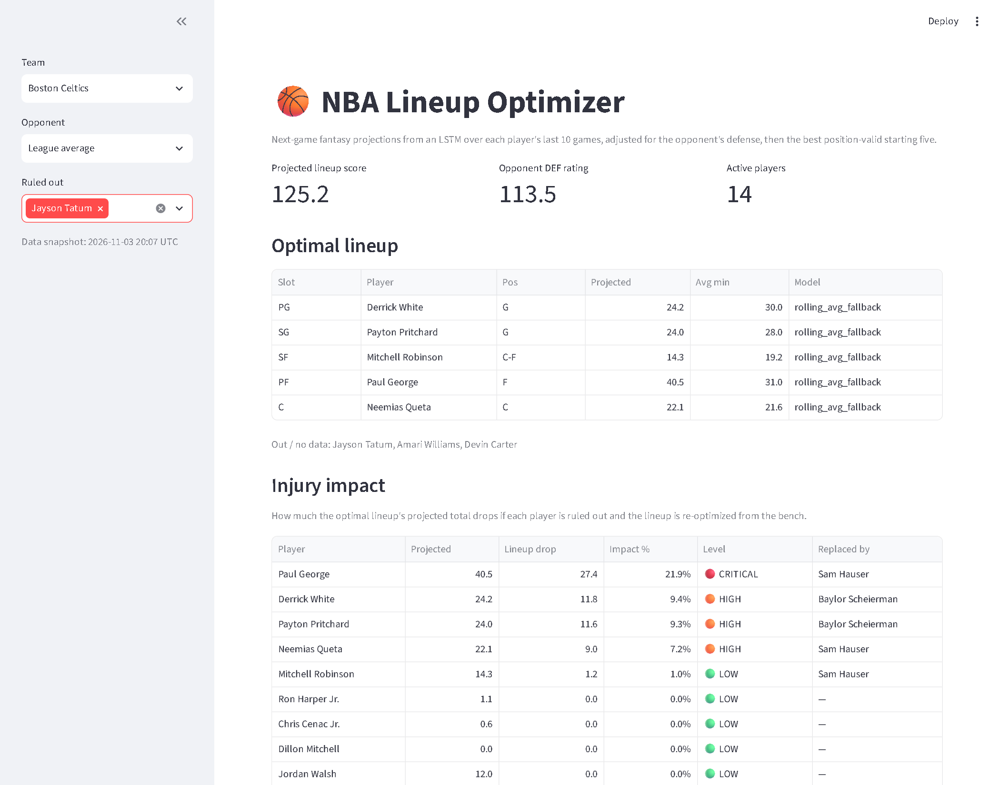

# NBA Lineup Optimizer

[](https://github.com/danieldelgado25/nba_optimizer/actions/workflows/ci.yml)

Projects each NBA player's next-game fantasy score with a PyTorch LSTM, picks the
best position-valid starting five, and measures how much each player's absence
would cost the lineup.

**[Live demo →](https://nba-lineup-optimizer.streamlit.app/)**



## Results

The LSTM was trained on the 2025-26 regular season (525 players, all 30 teams) and
evaluated on the last 20% of each player's games, which were held out of training.

| Model | MAE | RMSE |
|---|---|---|
| **LSTM** (10-game window) | **8.16** | **10.39** |
| Rolling 10-game average (baseline) | 8.36 | 10.74 |

Error is in fantasy points per game, across 4,373 held-out games. The LSTM cuts MAE
by **2.4%** and RMSE by **3.3%**. The baseline is a strong one: recent form explains
most of a player's next game, so any gain over it is hard to get.

## How it works

**1. Data** ([`data/fetcher.py`](src/nbaopt/data/fetcher.py)).
[`nba_api`](https://github.com/swar/nba_api) provides rosters, game logs, and team
defensive ratings. Each game's opponent is parsed from the matchup string
(`BOS @ MIA` → `MIA`) and joined to that team's DEF_RATING.

**2. Fantasy score.** Points ×1.0, rebounds ×1.2, assists ×1.5, steals and blocks ×3.0,
turnovers ×−1.0.

**3. LSTM projection** ([`models/predictor.py`](src/nbaopt/models/predictor.py))
- Input: the player's last 10 games, 12 features each (11 box-score stats + the
  upcoming opponent's DEF_RATING).
- A 2-layer LSTM (hidden size 64) feeds an MLP head that predicts the next game's score.
- Training windows never span two players, and features are normalized using
  training data only.
- Players with fewer than 10 games fall back to the rolling average scaled by
  opponent defense (capped at ±15%).
- Players averaging under 15 minutes are scaled down proportionally.

**4. Lineup optimization** ([`optimizer/lineup.py`](src/nbaopt/optimizer/lineup.py)).
Every 5-player combination is checked in order of total projected score. The first one
that can fill PG/SG/SF/PF/C with position-eligible players is the optimum. A
15-man roster has about 3,000 combinations, so this exact search runs instantly.

**5. Injury impact** ([`models/injury_impact.py`](src/nbaopt/models/injury_impact.py)).
The player is removed, the lineup is re-optimized, and the drop in projected total is
reported. Bench players have zero impact. A star's impact is the gap between them
and the best bench player who can replace them. Levels: 🔴 Critical (12%+),
🟠 High (7%+), 🟡 Moderate (3%+), 🟢 Low.

**6. Injury report.** Players ESPN's injury report lists as **Out** are ruled out
automatically, in the app (pre-ticked, so you can override) and the CLI (current
season only). **Day-To-Day** players stay active and are labeled, since game-time
calls are yours. The app reads the report live (cached 1h) and falls back to the
copy saved by `nbaopt snapshot`. The endpoint is unofficial, so if it is unreachable
nothing is ruled out automatically.

## Architecture

```
nbaopt snapshot ──► data/snapshot/*.csv ──► app.py (Streamlit)
      │                                        │
      └── data/fetcher.py (nba_api)            ├── models/predictor.py      LSTM + baseline
                                               ├── optimizer/lineup.py      exact lineup search
nbaopt train ──► artifacts/lstm_weights.pt     └── models/injury_impact.py  re-optimized drop
```

stats.nba.com blocks most cloud hosts. The deployed app therefore reads a committed
data snapshot instead of calling the API, and the snapshot is refreshed by running
`nbaopt snapshot` locally.

```
nba_optimizer/
├── src/nbaopt/
│   ├── cli.py                  # `nbaopt` entry point (lineup, train, snapshot)
│   ├── config.py               # Season / model path / snapshot settings
│   ├── train.py                # LSTM training + held-out evaluation
│   ├── snapshot.py             # Fetches data/snapshot/ for the app
│   ├── data/fetcher.py         # nba_api data layer
│   ├── models/predictor.py     # LSTM + rolling-average scoring
│   ├── models/injury_impact.py # Re-optimized lineup drop
│   └── optimizer/lineup.py     # Exact 5-man lineup search
├── app.py                      # Streamlit front end
├── artifacts/                  # Trained weights, normalizer, metrics
├── data/snapshot/              # Committed current-season data
├── tests/                      # Offline pytest suite (no network)
└── main.py, train.py           # Backwards-compatible aliases
```

## Run it locally

Requires Python 3.11 or 3.12.

```bash
python -m venv .venv
.venv/Scripts/activate          # macOS/Linux: source .venv/bin/activate
pip install -r requirements.txt # CPU torch + streamlit + the nbaopt package

streamlit run app.py            # web app (reads data/snapshot/)
```

**CLI** (calls the live API):

```bash
# Optimal lineup, adjusted for the opponent's defense
nbaopt lineup --team "Celtics" --opponent "Knicks"

# Mark players OUT (full names, or any part that matches exactly one player).
# Players ESPN lists as Out are added automatically; --no-injury-report turns that off.
nbaopt lineup --team "Celtics" --injured "Jayson Tatum, Jaylen Brown"

# Impact of one player being ruled out, or of every player
nbaopt lineup --team "Celtics" --injury-impact "Jayson Tatum"
nbaopt lineup --team "Celtics" --impact-report

# A specific season (default: current season, rolling over each October)
nbaopt lineup --team "Lakers" --season 2024-25
```

**Refresh data / retrain:**

```bash
nbaopt snapshot                 # current-season rosters + last 10 games, all teams (~8 min)
nbaopt train                    # last completed season, all teams; prints held-out eval
nbaopt train --team BOS --team DEN --epochs 10 --season 2024-25
```

`python main.py ...` and `python train.py ...` still work as aliases for `nbaopt lineup`
and `nbaopt train`.

### Configuration

| Variable | Default | Purpose |
| --- | --- | --- |
| `NBAOPT_SEASON` | derived from today's date | Season used for all API calls (`--season` overrides) |
| `NBAOPT_MODEL_PATH` | `./artifacts/lstm_weights.pt` | LSTM weights; the normalizer and metrics are stored next to it as `<path>.norm.npz` and `<path>.metrics.json` |

## Development

```bash
pip install -e ".[dev]"
pre-commit install              # optional, runs ruff on commit

make check                      # ruff + mypy + pytest
# without make:
ruff check . && ruff format --check . && mypy && pytest
```

The tests run offline against synthetic fixtures. CI runs the same checks on
Python 3.11 and 3.12.

## Limitations

- Each opponent's DEF_RATING comes from the end of that season, so the evaluation
  sees a little information from games that hadn't happened yet. The comparison is
  still fair because both models get the same feature.
- The epoch count (6) was chosen using the same held-out games, so the 2.4% is
  slightly optimistic. A clean test would retrain and evaluate on a later season.
- The data snapshot is refreshed manually, not on a schedule.
- Early in a season, most players have fewer than 10 games, so most projections
  use the rolling-average fallback.

## License

MIT
